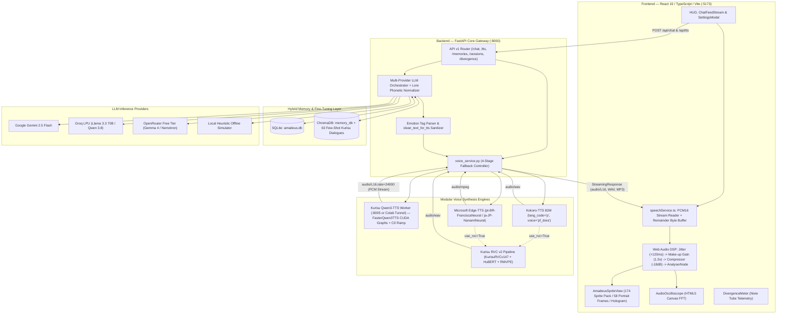

# OpenAmadeus Companion

A full-stack, modular multimodal conversational AI runtime inspired by the **Amadeus System** from *Steins;Gate 0*. It features interactive visual novel sprite animations (with a copyright-safe procedural holographic silhouette fallback), audio-reactive procedural lip-sync, real-time HTML5 Canvas oscilloscope and Nixie Tube divergence telemetry, ultra-low-latency neural voice cloning (**Kurisu Qwen3-TTS with CUDA Graphs**, **Kokoro-TTS 82M**, **Microsoft Edge-TTS**, and **Kurisu RVC v2**), Dynamic Few-Shot Retrieval-Augmented Generation (RAG), and fault-tolerant multi-provider LLM orchestration.

[](https://semver.org/)
[](https://www.gnu.org/licenses/gpl-3.0.html)
[](https://www.typescriptlang.org/)
[](https://react.dev/)
[](https://fastapi.tiangolo.com/)
[](https://www.python.org/)
[](https://huggingface.co/starrydark/Kurisu_Qwen3_TTS)
[](https://github.com/andimarafioti/faster-qwen3-tts)
[](https://kokorottsai.com/)
[](https://huggingface.co/FrancescoCaracciolo/Kurisu-RVC)
[](https://www.trychroma.com/)
[](https://www.docker.com/)

## 🔬 Overview

**OpenAmadeus Companion** ([lucca3447/amadeus](https://github.com/lucca3447/amadeus)) recreates the digitalized persona and consciousness of neuroscientist **Makise Kurisu** (Viktor Chondria University — Lab 304) using strict natural language system directives, episodic semantic memory retrieval, and synchronized audiovisual rendering across 10+ languages (including native cross-lingual support for **Brazilian Portuguese**, **English**, and **Japanese**).

### Core Highlights

- **4-Stage Universal Voice Engine Cascade (`server/app/services/voice_service.py`)**:
  - **Stage 1 — Kurisu Qwen3-TTS (`qwen3` — Remote Colab Tunnel or Local CUDA GPU)**: End-to-end 1.7B neural synthesis (`starrydark/Kurisu_Qwen3_TTS` built on [Qwen3-TTS](https://github.com/QwenLM/Qwen3-TTS)) accelerated via [faster-qwen3-tts](https://github.com/andimarafioti/faster-qwen3-tts) static KV cache + CUDA Graphs, achieving **~391 ms Time-To-First-Audio (TTFA)** and **1.92x Real-Time Factor (RTF)** on a single NVIDIA L4 GPU.
  - **Stage 2 — Kokoro-TTS 82M + Optional Kurisu RVC v2 (`kokoro` — Local Offline CPU/GPU)**: Ultra-lightweight 82M-parameter Brazilian Portuguese neural synthesis ([Kokoro-TTS](https://kokorottsai.com/) `pf_dora`, ~80–150 ms latency, ~350 MB footprint) optionally piped through **Kurisu RVC v2** ([FrancescoCaracciolo/Kurisu-RVC](https://huggingface.co/FrancescoCaracciolo/Kurisu-RVC)) to morph speech into the timbre of voice actress **Asami Imai (今井 麻美)**.
  - **Stage 3 — Microsoft Edge-TTS + Optional Kurisu RVC v2 (`edge_rvc` — Zero-Setup Cloud CPU)**: Runs out-of-the-box on any machine with 0 MB local weight downloads (`pt-BR-FranciscaNeural`, `pt-BR-ThalitaNeural`, `ja-JP-NanamiNeural`).
  - **Stage 4 — Browser Web Speech API Fallback**: Automatic client-side `SpeechSynthesisUtterance` fallback with word-boundary syllable lip-sync if the backend is unreachable.
- **Real-Time PCM16 Streaming & Web Audio DSP Chain**:
  - Server-side $C^0$ boundary continuity ramp (120-sample / 5 ms linear interpolation across 24 kHz chunk borders) eliminating inter-chunk clicks, paired with `clean_text_for_tts` punctuation sanitization (`?!` / `!!` filtering) and 21 studio-dry acoustic emotion prompts (`emotion_mapper.py`).
  - Client-side (`src/services/speechService.ts`) 16-bit remainder-byte alignment buffer for HTTP chunked streams, 120 ms initial jitter buffer, `1.5x` (+3.5 dB) pre-compression make-up `GainNode`, and `DynamicsCompressorNode` (`-18 dB` threshold, `3.5:1` ratio) for uniform loudness between shy whispers and emphatic retorts.
- **Visual State Machine & Audio-Reactive HUD**:
  - Supports **174 visual novel sprite assets** mapped across **21 emotional states** (`AmadeusSpriteView.tsx`), falling back natively to a stylized procedural holographic silhouette when proprietary sprites are absent.
  - Real-time FFT vocal-band frequency analysis (`300–3500 Hz`) driving mouth frames, stochastic eye-blinking, an HTML5 Canvas **Audio Oscilloscope** (`AudioOscilloscope.tsx`), and a **Nixie Tube Worldline Divergence Meter** (`DivergenceMeter.tsx`).
- **Dynamic Few-Shot RAG & Episodic Memory (`server/training/` & [ChromaDB](https://www.trychroma.com/))**:
  - Automatically indexes **63 curated ChatML conversation pairs** (`kurisu_finetuning_dataset_enhanced.jsonl`) into [ChromaDB](https://www.trychroma.com/) (`server/data/memory_db`) alongside persistent **SQLite** session logs (`server/data/amadeus.db`), plus Unsloth LoRA fine-tuning scripts (`unsloth_finetuning.py`) and an Ollama `Modelfile`.
- **Multi-Provider LLM Orchestration (`server/app/services/llm/`)**:
  - Fault-tolerant routing across **Google Gemini** (`gemini-2.5-flash`), **Groq Cloud LPU** (`llama-3.3-70b-versatile`, `qwen/qwen3.8-27b`), **OpenRouter Free Tier** (`gemma-4-31b-it:free`, `nemotron-3.5-lightning:free`), local **Ollama**, and an offline **Heuristic Simulator** (`offline_simulator.py`).

## 💻 Universal Hardware Compatibility & Benchmarks

OpenAmadeus scales from CPU-only laptops to local NVIDIA GPUs and free/low-cost Google Colab workers:

| Tier / Engine | Execution Mode | Hardware / VRAM | First Audio (TTFA) | Speed (RTF) | Notes & Capabilities |
| :--- | :--- | :--- | :--- | :--- | :--- |
| **Tier 1: Edge-TTS** *(Universal)* | Cloud Neural Stream | **Any PC / Laptop (0 GB VRAM)** | ~400–900 ms | > 3.00x | Zero downloads required; works out-of-the-box on Windows, macOS, and Linux |
| **Tier 2: Kokoro-TTS 82M** *(Offline)* | Local CPU / GPU | **CPU or GPU (~350 MB RAM/VRAM)** | ~80–300 ms | > 2.50x | 100% offline PT-BR synthesis (`pf_dora`), zero cloud dependency |
| **Tier 3: Kokoro / Edge + RVC v2** | Local Timbre Morph | **NVIDIA GPU (~2–4 GB VRAM FP16)** | ~800–1,500 ms | ~1.50x | Converts Kokoro or Edge speech into Asami Imai's acoustic timbre (`KurisuRVCv147`) |
| **Tier 4: Qwen3-TTS (`faster`)** | **Streaming PCM16 (CUDA Graphs)** | **Colab L4/A100 or Local GPU (~4–6 GB VRAM)** | **~391 ms** | **1.92x** *(L4)* | End-to-end Kurisu synthesis with sighs, hesitation pauses (`...`), and 21 emotions |
| **Tier 4 (Legacy): Qwen3-TTS (`stock`)** | Batch WAV (Dynamic Cache) | NVIDIA GPU (~6 GB VRAM) | ~14,000–20,000 ms | ~0.44x | Fallback batch mode when `faster-qwen3-tts` is disabled (`QWEN_BACKEND=stock`) |

## 🏛️ System Architecture & DSP Pipeline



## 🎙️ Neural Voice Models & Asset Setup

Switch between voice engines dynamically at runtime via the in-app **Settings Modal (⚙️)**:

### 1. Kurisu Qwen3-TTS 1.7B (End-to-End Neural Streaming)
- **Hugging Face Checkpoint**: `starrydark/Kurisu_Qwen3_TTS` (`CustomVoice` 1.7B BF16, speaker ID `kurisu`, built on [Qwen3-TTS](https://github.com/QwenLM/Qwen3-TTS)).
- **Acceleration Runtime**: [andimarafioti/faster-qwen3-tts](https://github.com/andimarafioti/faster-qwen3-tts) (captures the 28-layer Talker and 15-step Code Predictor into static-cache CUDA Graphs, cutting per-step latency from ~330 ms to ~54 ms).
- **Automatic Weight Caching**: Weights (~3.8 GB) are downloaded automatically on first startup into `~/.cache/huggingface/hub/`.
- **Manual Offline Clone (Optional)**:
  ```bash
  git lfs install
  git clone https://huggingface.co/starrydark/Kurisu_Qwen3_TTS server/weights/kurisu_qwen3
  ```

### 2. Kurisu RVC v2 (Retrieval-based Voice Conversion)
- **Hugging Face Checkpoint**: [FrancescoCaracciolo/Kurisu-RVC](https://huggingface.co/FrancescoCaracciolo/Kurisu-RVC)
- **Directory Layout**: Place `KurisuRVCv147.pth` and `KurisuRVCv147.index` inside `server/weights/kurisu_rvc/`:
  ```text
  server/
  └── weights/
      ├── kurisu_rvc/
      │   ├── KurisuRVCv147.pth
      │   └── KurisuRVCv147.index
      └── models/
          ├── hubert_base.pt
          └── rmvpe.pt
  ```

### 3. Visual Novel Sprite Pack Verification (Optional)
To respect intellectual property, commercial *Steins;Gate* sprites are not tracked in Git. OpenAmadeus renders a procedural holographic silhouette out-of-the-box. To enable the full 174-sprite visual pack locally, place your `.png` assets in `public/assets/sprites/kurisu/` and verify with:
```bash
python scripts/setup_sprites.py
```

## 🚀 Quick Start Guide

### Prerequisites
- **Node.js**: v18.0.0+ (v20+ recommended)
- **Python**: 3.10+
- **GPU (Optional)**: NVIDIA GPU (CUDA 12.4+) or a Google Colab session (L4/A100 recommended).

### Step 1: Launch Frontend (`:5173`)

```bash
npm install
npm run dev
```
The visual novel interface will be live at **`http://localhost:5173`**.

### Step 2: Launch Core [FastAPI](https://fastapi.tiangolo.com/) Backend (`:8000`)

```powershell
# Windows (PowerShell):
cd server
python -m venv rvc_env
.\rvc_env\Scripts\Activate.ps1
pip install -r requirements.txt
python -m uvicorn main:app --reload --port 8000  # or: python main.py

# Linux / macOS:
cd server
python3 -m venv rvc_env
source rvc_env/bin/activate
pip install -r requirements.txt
python -m uvicorn main:app --reload --port 8000  # or: python main.py
```
Interactive Swagger API documentation is available at **`http://localhost:8000/docs`**.

### Step 3: Enable Real-Time Kurisu Qwen3-TTS (Google Colab or Local GPU)

#### Option A: Remote Google Colab GPU Worker (Recommended — Zero Local VRAM Needed)
1. Upload or open `notebooks/Amadeus_Qwen3_TTS_Colab.ipynb` in Google Colab and select the **NVIDIA L4** (best cost/latency ratio) or **A100** runtime.
2. Execute the cells. The notebook automatically installs `sox`, pins `transformers==5.15.1`, installs [faster-qwen3-tts](https://github.com/andimarafioti/faster-qwen3-tts), captures CUDA Graphs, warms up the Mimi audio decoder, and prints a public **Cloudflare Tunnel URL** (`https://*.trycloudflare.com`).
3. Open **Settings (⚙️)** in OpenAmadeus, select **Qwen3-TTS (Remote Colab)**, and paste the tunnel URL (or set `QWEN_REMOTE_URL` in `server/.env`).

#### Option B: Local NVIDIA GPU Worker (`:8005`)
```powershell
cd server
python -m venv qwen_env
.\qwen_env\Scripts\Activate.ps1  # Linux/macOS: source qwen_env/bin/activate

# Install CUDA PyTorch + pinned Qwen3-TTS streaming dependencies
pip uninstall -y qwen-tts
pip install -r requirements-qwen.txt

# Launch worker (auto-detected by FastAPI on port 8005 if server/qwen_env exists)
python -m app.services.qwen_tts.qwen_worker
```

## 🧠 Kurisu Fine-Tuning & Dynamic Few-Shot RAG Pack (`server/training/`)

The `server/training/` directory ships with a complete persona alignment toolkit:
- **Automatic Dynamic Few-Shot RAG (Zero Setup)**: On startup, `memory_store.py` indexes `kurisu_finetuning_dataset_enhanced.jsonl` (63 refined multi-turn dialogues with `<!--emotion:xxx-->` and `<!--remember:...-->` tags) into [ChromaDB](https://www.trychroma.com/), injecting the most semantically relevant canon responses into every LLM prompt.
- **Local Ollama Model Creation**:
  ```bash
  cd server/training
  ollama create amadeus-kurisu -f Modelfile
  ollama run amadeus-kurisu
  ```
- **15-Minute Unsloth LoRA Fine-Tuning**: Use `server/training/unsloth_finetuning.py` on a free Google Colab T4 GPU to train and export custom GGUF weights.

## 🐳 Docker Deployment

Spin up the full-stack environment (`amadeus-frontend` on Nginx `:5173` + `amadeus-backend` on [FastAPI](https://fastapi.tiangolo.com/) `:8000`) with persistent volumes:

```bash
docker compose up --build -d
```

## ⚙️ Configuration & REST API Reference

### LLM Providers (Configurable in Settings ⚙️ or Environment)

| Provider | Key Format | Supported / Default Models | Dashboard |
| :--- | :--- | :--- | :--- |
| **Google Gemini** | `AIzaSy...` | `gemini-2.5-flash`, `gemini-1.5-flash` | `aistudio.google.com` |
| **Groq Cloud LPU** | `gsk_...` | `llama-3.3-70b-versatile`, `qwen/qwen3.8-27b`, `openai/gpt-oss-120b` | `console.groq.com` |
| **OpenRouter** | `sk-or-...` | `google/gemma-4-31b-it:free`, `nvidia/nemotron-3.5-lightning:free` | `openrouter.ai` |
| **Offline Simulator** | *None* | Deterministic Heuristic Persona Simulator | *100% Offline* |

### Primary Backend Endpoints (`http://localhost:8000`)

| Endpoint | Method | Description |
| :--- | :--- | :--- |
| `/api/health` | `GET` | Core gateway health, ChromaDB vector count, and active subsystem status |
| `/api/chat` | `POST` | Conversational turn execution with RAG retrieval, emotion parsing, and LLM fallback |
| `/api/tts` | `POST` | Universal speech synthesis (`audio/L16;rate=24000` PCM stream, `audio/wav`, or `audio/mpeg`) |
| `/api/voice/status` | `GET` | Real-time diagnostics across Remote Qwen3, Local Qwen3 (`:8005`), Kokoro, and RVC v2 |
| `/api/voice/ping` | `POST` | Probes Qwen3-TTS worker `/health` and measures round-trip latency + allocated VRAM |
| `/api/voice/models` | `GET` | Lists discovered RVC checkpoints, Kokoro voices (`pf_dora`), and Edge-TTS voices |
| `/api/memories` | `GET` / `POST` / `DELETE` | Episodic semantic memory inspection and management (ChromaDB + SQLite) |
| `/api/sessions` | `GET` / `POST` / `DELETE` | Conversation session persistence and history retrieval |
| `/api/divergence` | `GET` | Worldline divergence meter telemetry for the Nixie Tube display |

## 📁 Repository Structure

```text
OpenAmadeus/
├── notebooks/
│   ├── Amadeus_Qwen3_TTS_Colab.ipynb  # Remote Colab GPU worker (FasterQwen3TTS + Cloudflare Tunnel)
│   └── spike_faster_qwen3.py          # TTFA/RTF benchmark & audio parity validation script
├── public/
│   ├── amadeus-icon.svg               # Application vector emblem
│   └── assets/sprites/kurisu/         # Local destination for optional 174 sprite PNGs (gitignored)
├── scripts/
│   └── setup_sprites.py               # Sprite asset pack validator and directory initializer
├── server/                            # FastAPI Python Backend
│   ├── app/
│   │   ├── api/v1/endpoints/          # Modular route handlers (chat, voice, memory, persona, divergence)
│   │   ├── core/                      # config.py paths, model lists, and FastAPI lifespan
│   │   ├── db/                        # Hybrid SQLite + ChromaDB vector persistence (memory_store.py)
│   │   ├── schemas/                   # Pydantic request/response contracts (chat, memory, voice)
│   │   └── services/
│   │       ├── llm/                   # Multi-provider orchestrator (gemini.py, groq.py, openrouter.py)
│   │       ├── qwen_tts/              # qwen_worker.py, qwen_manager.py, emotion_mapper.py (21 states)
│   │       ├── kokoro_tts/            # kokoro_manager.py (82M PT-BR local synthesis)
│   │       ├── rvc/                   # rvc_manager.py, rvc_worker.py, pipeline.py (HuBERT/RMVPE)
│   │       ├── voice_service.py       # 4-stage voice cascade & clean_text_for_tts sanitizer
│   │       ├── emotion_service.py     # Sentiment tag extraction & pose synchronization
│   │       ├── divergence_service.py  # Worldline divergence state calculator
│   │       └── offline_simulator.py   # Zero-internet heuristic dialogue fallback
│   ├── personas/                      # Persona definitions and system prompts (kurisu.json)
│   ├── training/                      # 63-pair ChatML dataset, Unsloth LoRA script, Ollama Modelfile
│   ├── tests/                         # Unit, benchmark & E2E suites (test_qwen_tts.py, test_backend.py)
│   ├── weights/                       # Local model directory (kurisu_rvc/, kurisu_qwen3/, models/)
│   ├── main.py                        # FastAPI gateway entry point
│   ├── remote_worker.py               # Standalone remote worker runner
│   ├── requirements.txt               # Universal CPU backend dependencies
│   └── requirements-qwen.txt          # GPU worker dependencies (faster-qwen3-tts, transformers==5.15.1)
├── src/                               # React 19 + TypeScript + Vite Frontend
│   ├── components/                    # AmadeusSpriteView, AudioOscilloscope, DivergenceMeter, etc.
│   ├── data/personas/                 # Frontend persona metadata (kurisu.ts)
│   ├── services/                      # speechService.ts (Web Audio PCM16 DSP), aiService, spriteCatalog
│   ├── types/                         # TypeScript domain contracts (amadeus.ts)
│   ├── App.tsx                        # Main visual novel & call state orchestrator
│   └── main.tsx                       # React DOM entry point
├── docker-compose.yml                 # Full-stack multi-container orchestration
├── Dockerfile                         # Multi-stage frontend production build
└── package.json                       # Frontend dependencies and build scripts
```

## 🧪 Testing & Quality Assurance

Run the automated test suites before submitting pull requests:

```bash
# 1. Backend unit tests (core API, Qwen3 streaming, C0 DSP ramp, text sanitizer, and RVC)
python -m unittest discover -s server/tests -p "test_*.py"

# 2. Frontend TypeScript strict type-checking and production build verification
npx tsc --noEmit
npm run build
```

## 🗺️ Roadmap

OpenAmadeus follows [Semantic Versioning 2.0.0](https://semver.org/) (`MAJOR.MINOR.PATCH`). Below is our planned evolutionary track:

- **`v0.1.0` (Current)**: Real-time Qwen3-TTS CUDA Graphs streaming (~391ms TTFA), $C^0$ boundary DSP ramp, Web Audio compressor, and 4-stage voice fallback cascade.
- **`v0.2.0`**: 21-emotion acoustic calibration (`emotion_mapper.py`), 174-sprite camera & pose state machine, hands-free VAD & push-to-talk audio UX, and modern dev/tech persona tuning.
- **`v0.3.0`**: Multilingual expansion, persona cultural variants (PT-BR, EN, JA), and dynamic code-switching TTS.
- **`v0.4.0`**: Multimodal screen vision (`getDisplayMedia`) with on-demand snapshot inspection and region analysis.
- **`v0.5.0`**: Floating desktop pop-up / overlay (*Always-on-Top* companion) and continuous co-pilot monitoring.
- **`v1.0.0`**: Public API freeze, one-click standalone installer, and fully GPU-orchestrated Docker release.

## 🤝 Contributing, Versioning & Commit Standards

Contributions, bug reports, and acoustic calibration improvements are welcome!

1. **Versioning**: This project adheres to [Semantic Versioning 2.0.0](https://semver.org/) (`MAJOR.MINOR.PATCH`).
2. **Branching**: Create a feature branch from `main` (e.g., `feat/faster-qwen3-tts` or `feat/emotion-calibration`).
3. **Commit Format**: Use **atomic commits** following the [Conventional Commits](https://www.conventionalcommits.org/en/v1.0.0/) specification:
   - `feat(qwen-tts): ...` for synthesis worker, CUDA Graph runtime, and boundary DSP features
   - `feat(voice): ...` for fallback orchestration, text sanitization, and `emotion_mapper.py` tuning
   - `feat(frontend): ...` for UI components, Web Audio API DSP, and lip-sync updates
   - `chore(colab): ...` for notebook and remote worker tooling
   - `test(voice): ...` for unit and integration tests
4. **Verification**: Ensure all Python unit tests and `npx tsc --noEmit` pass cleanly before opening a Pull Request.

## 🙏 Credits & Acknowledgments

- **starrydark / Kurisu_Qwen3_TTS** (`https://huggingface.co/starrydark/Kurisu_Qwen3_TTS`): Fine-tuned neural voice synthesis model of Makise Kurisu based on Alibaba Cloud Qwen3-TTS 1.7B.
- **[andimarafioti / faster-qwen3-tts](https://github.com/andimarafioti/faster-qwen3-tts)**: Real-time Qwen3-TTS inference engine using static KV cache and CUDA Graphs.
- **[FrancescoCaracciolo / Kurisu-RVC](https://huggingface.co/FrancescoCaracciolo/Kurisu-RVC)**: Trained Makise Kurisu RVC v2 voice model (`KurisuRVCv147.pth` and `KurisuRVCv147.index`).
- **[Alibaba Cloud / Qwen Team](https://github.com/QwenLM/Qwen3-TTS)**: Qwen3-TTS base architecture and 12 Hz speech tokenizer.
- **[Kokoro-TTS](https://kokorottsai.com/)**: Lightweight 82M-parameter open-weight multilingual neural TTS engine.
- **Asami Imai (今井 麻美)**: Official Japanese voice actress for Makise Kurisu, whose iconic performance defines the character.
- **RVC Community & Microsoft Azure / Edge-TTS**: Open-source retrieval-based voice conversion and cloud neural speech synthesis.

## ⚖️ Legal Disclaimer & Intellectual Property Notice

> **Non-Commercial Project:**  
> **OpenAmadeus Companion** is an independent, non-commercial open-source research and educational tribute project inspired by *Steins;Gate 0*. It is free, non-monetized, and open to the community for exploring human-computer interaction and multimodal conversational agents under the [GNU General Public License v3.0](https://www.gnu.org/licenses/gpl-3.0.html).
> 
> **Trademarks & Copyrights:**  
> All characters, names, lore, and visual assets related to *STEINS;GATE* (including *Makise Kurisu*, *Amadeus System*, *Viktor Chondria University*, and *Lab 304*) are registered trademarks and copyrighted properties of **MAGES. Inc. / 5pb. / Chiyomaru Studio / KADOKAWA**. This project is not affiliated with, endorsed by, or sponsored by these entities.
> 
> **Voice Models & Attribution:**  
> The community acoustic models (RVC v2 and Qwen3-TTS) are hosted externally on Hugging Face by independent researchers. They represent experimental synthetic voice emulation and are neither officially endorsed by nor affiliated with the official Japanese voice actress **Asami Imai (今井 麻美)**.
> 
> **Asset Distribution Policy:**  
> To respect copyright boundaries, **no commercial game assets or sprite images are bundled or tracked in this Git repository**. The engine functions natively with a stylized procedural holographic silhouette. Users wishing to apply local character sprites do so privately on their own machines (`python scripts/setup_sprites.py`).
> 
> **Notice & Takedown:**  
> If you are a copyright holder and believe any material exceeds fair use or infringes your rights, please open an Issue for prompt resolution or removal.
