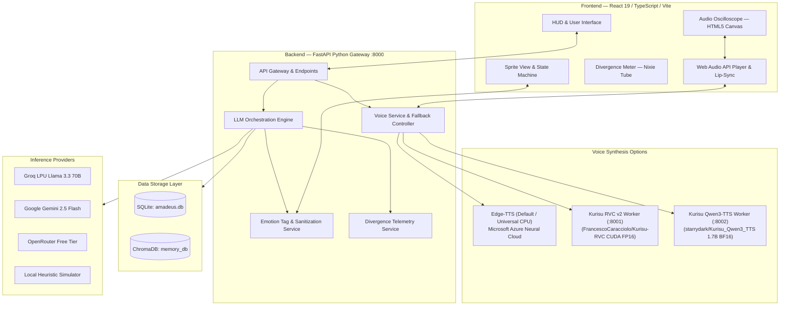

# Amadeus (System Kurisu)

A full-stack, multimodal conversational AI application featuring interactive visual novel sprite animations, audio-reactive procedural lip-sync, acoustic waveform visualization, neural voice synthesis (End-to-End Kurisu Qwen3-TTS & Edge-TTS + Kurisu RVC v2), local Retrieval-Augmented Generation (RAG), and multi-provider LLM orchestration.

[](https://www.gnu.org/licenses/gpl-3.0)
[](https://www.typescriptlang.org/)
[](https://react.dev/)
[](https://fastapi.tiangolo.com/)
[](https://www.python.org/)
[](https://huggingface.co/starrydark/Kurisu_Qwen3_TTS)
[](https://huggingface.co/FrancescoCaracciolo/Kurisu-RVC/tree/main)
[](https://www.trychroma.com/)
[](https://www.docker.com/)

---

## 🔬 Overview

**Amadeus** is an advanced conversational AI interface inspired by the fictional Amadeus system from *Steins;Gate 0*. The application recreates the digitalized persona and consciousness of neuroscientist **Makise Kurisu** (Viktor Chondria University - Lab 304) using strict natural language system directives, episodic semantic memory retrieval, and synchronized audiovisual rendering.

 Amadeus integrates:
- **Universal Voice Engine Architecture**:
  - **Edge-TTS (Default / Universal)**: Runs on **any machine (CPU-only)** with zero setup, 0 MB model downloads, and crystal-clear pronunciation.
  - **Kurisu RVC v2 (Timbre Conversion - Optional GPU)**: Converts speech in real-time into the acoustic timbre of official Japanese voice actress **Asami Imai (今井 麻美)** using weights from [FrancescoCaracciolo/Kurisu-RVC](https://huggingface.co/FrancescoCaracciolo/Kurisu-RVC/tree/main).
  - **Kurisu Qwen3-TTS (End-to-End Neural - Optional GPU)**: Direct neural voice synthesis based on Alibaba Cloud Qwen3-TTS (1.7B), trained by [starrydark/Kurisu_Qwen3_TTS](https://huggingface.co/starrydark/Kurisu_Qwen3_TTS) with tsundere expressions, studio dry acoustic conditioning, and sentence-chunked breath pauses.
- **Visual State Machine**: 174 high-resolution visual novel sprite assets dynamically synchronized with LLM sentiment metadata across 21 emotional states.
- **Procedural Lip-Sync & Blinking**: Web Audio API frequency analysis coupled with syllable-accurate mouth movement and stochastic eye-blink cycles.
- **Hybrid RAG Memory Architecture**: Local vector similarity search (ChromaDB) combined with relational session persistence (SQLite).
- **Multi-Provider LLM Orchestration**: Fault-tolerant routing across Groq Cloud (LPU Llama 3.3 70B), Google Gemini (2.5 Flash), OpenRouter, and a deterministic local offline simulator.
- **Containerization Support**: Complete Docker and Docker Compose environment ready for deployment.
- **Acoustic Waveform Oscilloscope**: Real-time sine wave rendering on an HTML5 Canvas matching speech synthesis amplitude and frequency.
---

## 💻 Universal Hardware Compatibility

Amadeus is engineered to run seamlessly across all systems:

| Hardware Tier | Supported Systems | Voice Synthesizer | VRAM Required | Notes |
| :--- | :--- | :--- | :--- | :--- |
| **Tier 1: Standard (Default)** | **ANY PC / Laptop** (Windows, macOS, Linux) | **Microsoft Edge-TTS** | **0 GB (CPU-Only)** | • Zero downloads required<br/>• Instant startup out-of-the-box<br/>• Smooth performance on everyday computers |
| **Tier 2: Enhanced (Optional)** | **NVIDIA GPU** (GTX 16-series, RTX 20/30/40 series, 4GB+ VRAM) | **Kurisu RVC v2** | ~2–4 GB VRAM (CUDA FP16) | • Cloned Japanese timbre (Asami Imai)<br/>• Real-time pitch & harmonic conversion |
| **Tier 3: Advanced (Optional)** | **NVIDIA GPU** (RTX 20/30/40 series, 6GB+ VRAM recommended) | **Kurisu Qwen3-TTS** | ~4–6 GB VRAM (CUDA BF16) | • End-to-end direct voice synthesis<br/>• Expressive pauses, sighs, and emotional inflections |

> [!NOTE]
> If your system does not have a dedicated NVIDIA GPU, Amadeus automatically uses **Microsoft Edge-TTS** with zero manual configuration. Everything works completely and fluently out-of-the-box!

---

## 🏛️ System Architecture



---

## 🎙️ Neural Voice Models & Where to Download

Switch between voice engines dynamically via the in-app **Settings Modal (⚙️)**:

### 1. Microsoft Edge-TTS — [Universal / Default / 0 MB Download]
* **Cost & Setup**: 100% Free, no API keys, and requires no local downloads.
* **Voices**: `pt-BR-FranciscaNeural` (Natural & Expressive), `pt-BR-ThalitaNeural` (Fast), and `ja-JP-NanamiNeural` (Anime Original).
* **Compatibility**: Works on all computers (CPU-only).

### 2. Kurisu RVC v2 (Timbre Conversion) — [Optional GPU Acceleration]
* **Hugging Face Repository**: [FrancescoCaracciolo/Kurisu-RVC](https://huggingface.co/FrancescoCaracciolo/Kurisu-RVC/tree/main)
* **Voice Actor Reference**: Asami Imai (今井 麻美) — Official Japanese voice of Makise Kurisu.
* **Required Files**:
  * `KurisuRVCv147.pth` (RVC generator weights)
  * `KurisuRVCv147.index` (Faiss feature retrieval index)
* **Where to Place Files**:
  Download and save into `server/weights/kurisu_rvc/`:
  ```text
  server/
  └── weights/
      ├── kurisu_rvc/
      │   ├── KurisuRVCv147.pth
      │   └── KurisuRVCv147.index
      └── models/
          ├── hubert_base.pt
          └── rmvpe.pt
  ```

### 3. Kurisu Qwen3-TTS (End-to-End Neural Voice) — [Optional GPU Acceleration]
* **Hugging Face Repository**: [starrydark/Kurisu_Qwen3_TTS](https://huggingface.co/starrydark/Kurisu_Qwen3_TTS)
* **Base Architecture**: Alibaba Cloud Qwen3-TTS (1.7 Billion parameters)
* **Model Download Options**:
  * **Automatic Download (Recommended)**: You do not need to download the model manually. When the worker launches, it automatically downloads the model weights (~3.5 GB) directly from Hugging Face Hub and stores them in your global cache directory (`~/.cache/huggingface/hub/`).
  * **Manual Clone (Offline / Air-Gapped Machines)**:
    If your machine has restricted connectivity, clone the model directly into `server/weights/kurisu_qwen3/`:
    ```bash
    git lfs install
    git clone https://huggingface.co/starrydark/Kurisu_Qwen3_TTS server/weights/kurisu_qwen3
    ```
    The worker automatically detects and prioritizes `server/weights/kurisu_qwen3/` over remote downloading.
* **Hardware Requirements**: NVIDIA GPU with 4GB+ VRAM (CUDA 12.4, BF16 precision).
* **Inference Warning Note**: A `Warning: flash-attn is not installed. Will only run the manual PyTorch version` warning during startup is completely normal and harmless on Windows/consumer GPUs; PyTorch's native SDPA kernel runs inference smoothly with low latency.

---

## 🚀 Quick Start Guide (recommended)

### Prerequisites
* **Node.js**: v18.0.0+ (v20+ recommended)
* **Python**: 3.10+ (tested on Python 3.10 through 3.12)
* **GPU (Optional)**: Modern NVIDIA GPU with CUDA 12.4 (only needed if running local RVC or Qwen3-TTS).

---

### Step 1: Start Frontend

```bash
# In the root repository folder:
npm install
npm run dev
```
The interface will be live at **`http://localhost:5173`**.

---

### Step 2: Start Backend (Runs on ANY Machine)

Open a new terminal for the core server:

```powershell
# Windows (PowerShell):
cd server
python -m venv rvc_env
.\rvc_env\Scripts\Activate.ps1
pip install -r requirements.txt
python -m uvicorn main:app --reload --port 8000

# Linux / macOS:
cd server
python3 -m venv rvc_env
source rvc_env/bin/activate
pip install -r requirements.txt
python -m uvicorn main:app --reload --port 8000
```
The backend will be running at **`http://localhost:8000`** (Swagger API docs at `http://localhost:8000/docs`).

---

### Step 3: Optional — Start Qwen3-TTS Worker (NVIDIA GPU Only)

If you have an NVIDIA GPU and want direct end-to-end neural Kurisu speech:

```powershell
# Windows (PowerShell):
cd server
python -m venv qwen_env
.\qwen_env\Scripts\Activate.ps1
pip install torch==2.6.0+cu124 torchaudio==2.6.0+cu124 --extra-index-url https://download.pytorch.org/whl/cu124
pip install -r requirements-qwen.txt
python -m app.services.qwen_tts.qwen_worker

# Linux:
cd server
python3 -m venv qwen_env
source qwen_env/bin/activate
pip install torch==2.6.0+cu124 torchaudio==2.6.0+cu124 --extra-index-url https://download.pytorch.org/whl/cu124
pip install -r requirements-qwen.txt
python -m app.services.qwen_tts.qwen_worker
```

> [!TIP]
> **Auto-Spawn**: If `qwen_env` is set up inside `server/qwen_env`, you don't even need to launch the worker manually in a separate terminal. The FastAPI core server detects `server/qwen_env` and will automatically launch the worker process on port `8002` when Kurisu speech is requested.
>
> **Automatic Fallback**: If the Qwen3 worker is offline or the GPU runs out of memory, Amadeus instantly and gracefully falls back to Edge-TTS without interrupting your conversation.

---

## 🐳 Running with Docker & Docker Compose 

Amadeus includes full Docker containerization for one-command deployment:

```bash
# Build and start all services in the background:
docker compose up --build -d

# Or start interactively with real-time logs attached:
docker compose up --build
```

This starts two services in a shared bridge network:
- **`amadeus-frontend`**: High-performance Nginx Alpine on port `5173` serving the React SPA with `/api/` reverse proxy.
- **`amadeus-backend`**: FastAPI on port `8000` with data volume persistence (`./server/data:/app/data`).

To view logs:
```bash
docker compose logs -f
```

To stop:
```bash
docker compose down
```

### Enabling NVIDIA GPU in Docker (Optional)
If you have the [NVIDIA Container Toolkit](https://docs.nvidia.com/datacenter/cloud-native/container-toolkit/latest/install-guide.html) installed, add GPU reservations to `amadeus-backend` in `docker-compose.yml`:

```yaml
    deploy:
      resources:
        reservations:
          devices:
            - driver: nvidia
              count: all
              capabilities: [gpu]
```

---

## ⚙️ API Configuration

Configure your LLM API keys directly inside the application (**Settings ⚙️**). Keys are stored locally in `localStorage`:

| Provider | Key Format | Default Model | Free Dashboard |
| :--- | :--- | :--- | :--- |
| **Groq Cloud** (Recommended) | `gsk_...` | `llama-3.3-70b-versatile` | [console.groq.com](https://console.groq.com/) |
| **Google Gemini** | `AIzaSy...` | `gemini-2.5-flash` | [aistudio.google.com](https://aistudio.google.com/) |
| **OpenRouter** | `sk-or-...` | `meta-llama/llama-3.3-70b-instruct:free` | [openrouter.ai](https://openrouter.ai/) |
| **Offline Mode** | *None* | Local Heuristic Simulator | *No internet required* |

---

## 📁 Repository Structure

```text
amadeus/
├── public/                          # Static assets and character sprites
│   ├── amadeus-icon.svg             # Application logo
│   └── assets/sprites/kurisu/       # 174 high-resolution Kurisu visual novel sprites
├── server/                          # FastAPI Python backend
│   ├── app/
│   │   ├── api/v1/endpoints/        # REST routes (/chat, /tts, /memories, /sessions)
│   │   ├── core/                    # Configurations, file paths, and lifespan
│   │   ├── db/                      # Hybrid persistence (SQLite + ChromaDB)
│   │   ├── schemas/                 # Pydantic validation models
│   │   └── services/                # LLM orchestrator, emotion parser, voice services
│   │       ├── qwen_tts/            # Kurisu Qwen3-TTS manager and worker
│   │       └── rvc/                 # Kurisu RVC v2 pipeline and worker
│   ├── data/                        # Persistent databases (amadeus.db, memory_db)
│   ├── personas/                    # Persona profiles and system prompts in JSON
│   ├── tests/                       # Automated backend tests
│   ├── weights/                     # RVC weights (kurisu_rvc/KurisuRVCv147.pth, .index)
│   ├── Dockerfile                   # Backend Dockerfile
│   ├── requirements.txt             # Core backend requirements (CPU/Universal)
│   └── requirements-qwen.txt        # Optional GPU Qwen3-TTS requirements
├── src/                             # Frontend (React 19 + TypeScript + Vite)
│   ├── components/                  # SpriteView, Oscilloscope, SettingsModal, etc.
│   ├── services/                    # backendService, speechService, aiService
│   ├── types/                       # Shared TypeScript interface definitions
│   ├── App.tsx                      # Root component and state orchestrator
│   └── main.tsx                     # React application entry point
├── docker-compose.yml               # Multi-container orchestration
├── Dockerfile                       # Frontend multi-stage Docker build
├── nginx.conf                       # Production Nginx reverse proxy configuration
├── package.json                     # Node.js project metadata and dependencies
└── README.md                        # Project documentation
```

---

## 🧪 Testing & Quality Assurance

### Frontend Type-Checking & Build
```bash
npx tsc --noEmit
npm run build
```

### Backend Automated Test Suite
```bash
python -m unittest discover -s server/tests -p "test_backend.py"
```

---

## Credits 

Open-source projects, model creators, and communities used:

- **[FrancescoCaracciolo / Kurisu-RVC](https://huggingface.co/FrancescoCaracciolo/Kurisu-RVC/tree/main)**: The trained Makise Kurisu RVC v2 voice model (`KurisuRVCv147.pth` and `KurisuRVCv147.index`).
- **[starrydark / Kurisu_Qwen3_TTS](https://huggingface.co/starrydark/Kurisu_Qwen3_TTS)**: Fine-tuned neural voice synthesis model of Makise Kurisu based on Alibaba Cloud Qwen3-TTS 1.7B.
- **Alibaba Cloud / Tongyi Lab**: Qwen3-TTS.
- **Asami Imai (今井 麻美)**: Official Japanese voice actress for Makise Kurisu, whose performance defines the character's voice.
- **RVC Community (Retrieval-based Voice Conversion)**: Open-source real-time voice conversion algorithms and HuBERT/RMVPE models.
- **Microsoft Azure / Edge-TTS**: Neural speech synthesis.

---

## ⚖️ Disclaimer & Intellectual Property

- *Steins;Gate*, *Steins;Gate 0*, the character **Makise Kurisu**, related concepts, and visual novel sprite assets are the intellectual property of **MAGES. Inc. / 5pb. / Chiyomaru Shikura / Nitroplus**.
- This project is an independent, non-commercial open-source research and educational application created under Fair Use.
- Software is distributed under the [GNU General Public License v3](LICENSE).
